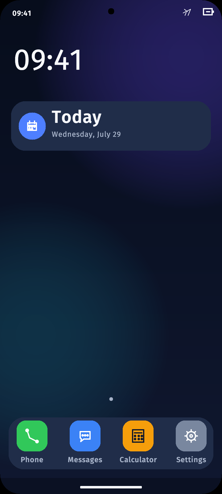

# Bndroid OS

Bndroid OS is an experimental Rust-first operating system that aims to reimplement the Android mobile experience on a non-Linux foundation. Its long-term goal is to become an alternative to Android while running Android applications through AndroidBox.

The repository contains a custom AArch64 kernel, supervised services, storage and UI subsystems, and AndroidBox: a bounded compatibility layer for verified APK ingestion, resource parsing, DEX interpretation, Activity projection, and lifecycle recovery.

The current system is a QEMU research prototype. General-purpose APK compatibility, a complete Android runtime, and production support for physical phones remain future work.

## Demo



This 720x1600 mobile UI screenshot was generated by `scripts/check-mobile-ui-runtime.sh` in local QEMU.

## Current scope

- A custom kernel targeting QEMU `virt` AArch64, with capability-based handles, VMOs, channels, events, and supervised processes.
- Storage, package, graphics, input, and application-data services with recovery tests.
- A 20:9 mobile shell with grouped Settings, Display and Accessibility pages, shared dynamic colors, semantic text sizes, and high-contrast appearance.
- Session-local Overview gestures, verified package icons, lock-screen notification dismissal, and SurfaceServer-owned minute-clock updates.
- Mapped double buffering for the mobile and bounded DEX0 previews; up to two damage regions in the 64-byte mobile `BufferPresent` v6 transaction.
- Region-based rendering and copying for layered AndroidBox, with separate written/presented caches, system-chrome reuse, and measured copy-volume checks.
- ABI 69 fixed-and-weighted horizontal layouts for controlled Android SDK/D8/AAPT2 APK fixtures.
- An isolated ABI 70 native-entry profile for NDK-compiled arm64 ELF programs, with a Linux startup stack, a small syscall subset, and supervised process cleanup.
- Static native Bionic startup with ELF TLS, Scudo allocation, stdio, constructors/destructors, and sparse private memory on the custom kernel.
- Unmodified Android dynamic linker and shared Bionic execution, with plugin loading, ELF TLS, immutable runtime files, private file mappings, and exit cleanup.
- Real Bionic pthreads with shared process memory/files, private TLS, futex waits, joins/detach, and thread-group exit/fault cleanup.
- Unmodified ART interpreter execution of a standard DEX program, with two Java startup/exit cycles and complete process/thread cleanup.
- Process/VM snapshots, stack guards, anonymous remapping, read-only shared runtime files, and real linker namespaces advance ART through ICU/core native-library initialization.
- AArch64 signal handlers and safe return, alternate stacks, interrupted waits, futex requeue and RTC-backed realtime clocks in the isolated ART profile.
- APK-contained DEX/JNI execution through upstream ART/linker, with real Java threads, GC/weak references, attached native threads and anonymous discard/demand-zero memory.
- Upstream `app_process64`/AndroidRuntime loading with verified Framework inputs, immutable boot properties and fixed-address memory relocation; complete system-service/Activity startup remains unfinished.
- Original Framework Parcel/Bundle round trips, cross-thread Looper wakeups and delayed callbacks in two normal startup/VM-shutdown cycles, using shared code-cache backing and runtime-loaded JNI.
- Real eventfd counters and epoll waits, including semaphore reads, edge/one-shot notification, nested watches, descriptor reuse, timeouts, signal masks and interrupted/restarted I/O.
- Cross-process Binder byte/object transactions, connection-scoped handles, reference handshakes, nested callbacks, per-object one-way ordering and death notifications, with read-only receive pools; FD transfer and ServiceManager remain unfinished. See [Binder Objects-1](docs/milestones/androidbox/BINDER_OBJECTS_1.md).

The shared software frame clock provides a nominal 50 Hz grant ceiling. It does not establish hardware VSync, measured FPS, or physical-device performance.

## Quick start

Install the Rust toolchain specified in `rust-toolchain.toml`, QEMU with AArch64 support, and Python 3.10 or newer. Run commands from the repository root:

```sh
./scripts/run-mobile-ui.sh
```

This opens the interactive phone demo with a temporary disk overlay. Swipe upward to unlock, click the dock icons, and swipe upward on Home to open All apps and the bundled AndroidBox demo. Close the QEMU window to stop. The demo uses a checked-in APK and does not require an Android SDK.

For a guided demonstration, or a repeatable check without a window:

```sh
./scripts/run-mobile-ui.sh --tour
./scripts/run-mobile-ui.sh --headless
```

The tour exercises Calculator, shared appearance/accessibility settings, and the bounded APK/DEX callback. Each run retains its own logs and screenshots under `target/mobile-ui/demo.*/`. See [the demo guide](docs/DEMO.md) for controls, prerequisites, and troubleshooting.

For the underlying kernel boot checks:

```sh
./scripts/build-kernel.sh
./scripts/check-qemu-boot.sh
```

For the mobile UI acceptance gate:

```sh
./scripts/check-mobile-ui-runtime.sh
```

AndroidBox SDK fixture gates additionally require the locally installed Android SDK/JDK tools described in their fixture READMEs. Generated builds, screenshots, and logs stay in the ignored `target/` directory.

Acquired ART/Bionic inputs and their new runtime acceptance records live under
ignored `.bndroid/`, independently of Cargo's build cache. The fixture guides
document extraction, existing-cache overrides and current limitations.

With a locally installed Android NDK, `./scripts/check-linux-abi-runtime.sh` validates the [native Linux ABI entry foundation](docs/milestones/androidbox/LINUX_ARM64_ENTRY.md). This separate profile does not yet initialize Bionic or ART.

`./scripts/check-bionic-runtime.sh` runs the [real static Bionic fixture](fixtures/bionic-arm64/README.md) using the installed NDK's unmodified libraries and temporary storage. It verifies native C execution; ART and general APK compatibility remain future work.

With locally extracted SDK runtime files, `./scripts/check-bionic-dynamic-runtime.sh` runs the [real Android dynamic linker fixture](fixtures/bionic-dynamic/README.md), including shared libc and a dynamically loaded plugin. The guide includes an isolated extraction helper and a fault-containment check.

`./scripts/check-bionic-threads.sh` verifies real pthread synchronization and four normal/fault lifecycle paths using those same local runtime inputs.

The [ART fixture guide](fixtures/art-runtime/README.md) provides local runtime extraction and managed Java, frontend, memory and signal gates. `./scripts/check-art-runtime.sh` runs the standard DEX fixture twice through real ART; `./scripts/check-art-signals.sh` verifies signal handling and five fault-containment cases. Full APK/Framework support remains incomplete.

`BNDROID_ART_MODE=managed ./scripts/check-art-runtime.sh` runs Java thread/GC/JNI checks from a signed APK, including direct loading of its native library. This is an APK command-line entry; ActivityThread, installation and app graphics are still pending.

`BNDROID_ART_MODE=binder ./scripts/check-art-runtime.sh` runs two concurrent native Bionic processes against the real Binder adapter. It verifies communication, peer death, interrupted reads and cleanup on a temporary disk. This is an initial transport gate, not full Android service compatibility.

`BNDROID_ART_MODE=poll ./scripts/check-art-runtime.sh` validates event notification and blocking I/O through native Bionic. With the full local Framework receipt, `BNDROID_ART_MODE=framework ./scripts/check-art-runtime.sh` verifies Parcel/Bundle, cross-thread wakeups, delayed callbacks and normal VM shutdown twice. ActivityThread and general APK graphics remain separate work.

## Documentation

- [Documentation index](docs/README.md): directory layout and milestone navigation.
- [Whitepaper](WHITEPAPER.md): architecture, technical position, and research boundaries.
- [Roadmap](TODO.md): the single source of truth for future work.
- [Implementation status](IMPLEMENTATION_STATUS.md): implemented behavior and recorded validation.
- [Project milestones](PROJECT_MILESTONES.md): historical evidence index.
- [Settings and accessibility](docs/milestones/ui/SETTINGS_DISPLAY_UI.md).
- [Mapped buffers and region rendering](docs/milestones/ui/MOBILE_MAPPED_BUFFERQUEUE.md).
- [AndroidBox mixed layouts](docs/milestones/androidbox/ANDROIDBOX_LAYOUT_MIXED_19.md).
- [Native arm64 entry and Linux ABI subset](docs/milestones/androidbox/LINUX_ARM64_ENTRY.md).
- [Real static Bionic startup](docs/milestones/androidbox/BIONIC_STATIC_0.md).
- [Android dynamic linker and shared Bionic](docs/milestones/androidbox/BIONIC_DYNAMIC_0.md).
- [Bionic threads and synchronization](docs/milestones/androidbox/BIONIC_THREADS_0.md).
- [ART frontend and low-address memory](docs/milestones/androidbox/ART_FRONTEND_0.md).
- [ART process metadata and core native initialization](docs/milestones/androidbox/ART_PROCESS_0.md).
- [ART signals and first managed Java execution](docs/milestones/androidbox/ART_SIGNALS_0.md).
- [ART managed threads, GC and JNI from an APK](docs/milestones/androidbox/ART_MANAGED_0.md).
- [Framework frontend, boot properties and fixed relocation](docs/milestones/androidbox/FRAMEWORK_FRONTEND_0.md).
- [Binder byte transport and Framework Parcel progress](docs/milestones/androidbox/BINDER_TRANSPORT_0.md).
- [Framework Looper, event notification and normal shutdown](docs/milestones/androidbox/FRAMEWORK_LOOPER_0.md).

Markdown documentation is maintained in English. Original multilingual milestone records are retained as verbatim text evidence in [the archive](docs/archive/README.md); English milestone pages summarize them and link to their full sources.

## Collaboration

External contributions should use a fork and pull request. Keep changes focused and provide reproducible checks, compatibility implications, and known limitations. See [CONTRIBUTING.md](CONTRIBUTING.md), [CODE_OF_CONDUCT.md](CODE_OF_CONDUCT.md), and [SECURITY.md](SECURITY.md).

Bndroid does not accept contributions intended to attack, damage, bypass authorization on, or abuse existing platforms. The main branch should be protected against force-pushes and deletion, with review required for external contributions.

## License

Source code is licensed under Apache License 2.0. Bndroid Sans Raster font data remains under the SIL Open Font License 1.1. See [LICENSE](LICENSE), [NOTICE](NOTICE), [LICENSES/](LICENSES/), and [.reuse/dep5](.reuse/dep5) for the license texts and file mapping.
